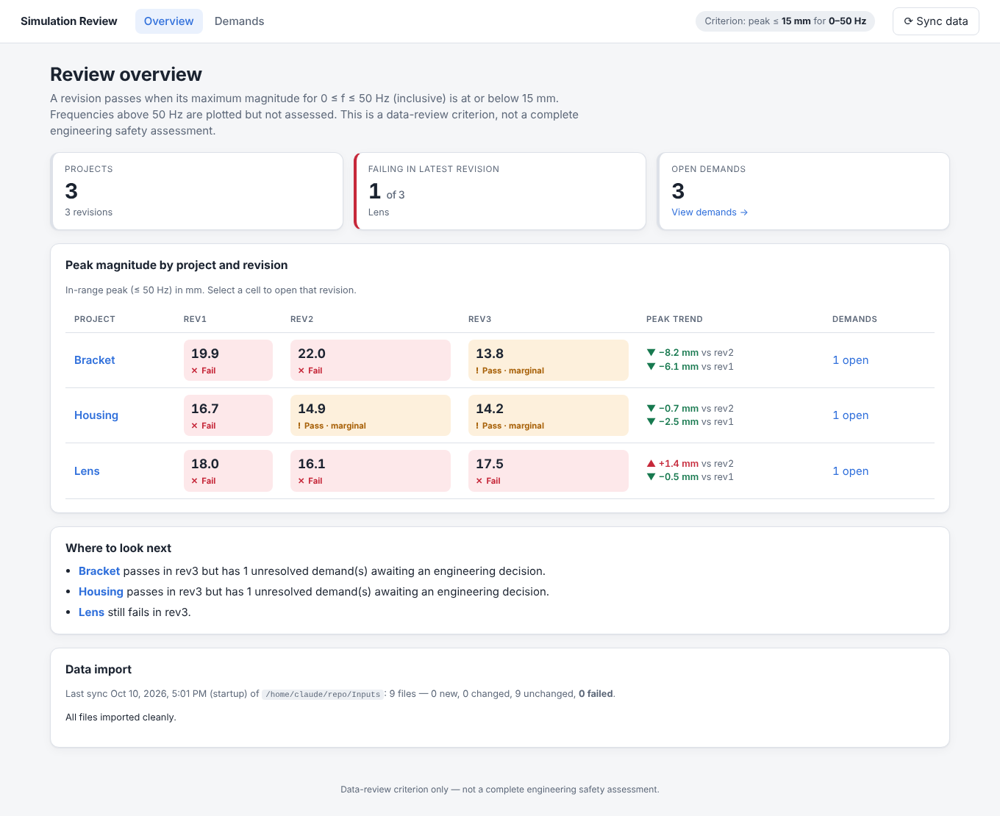
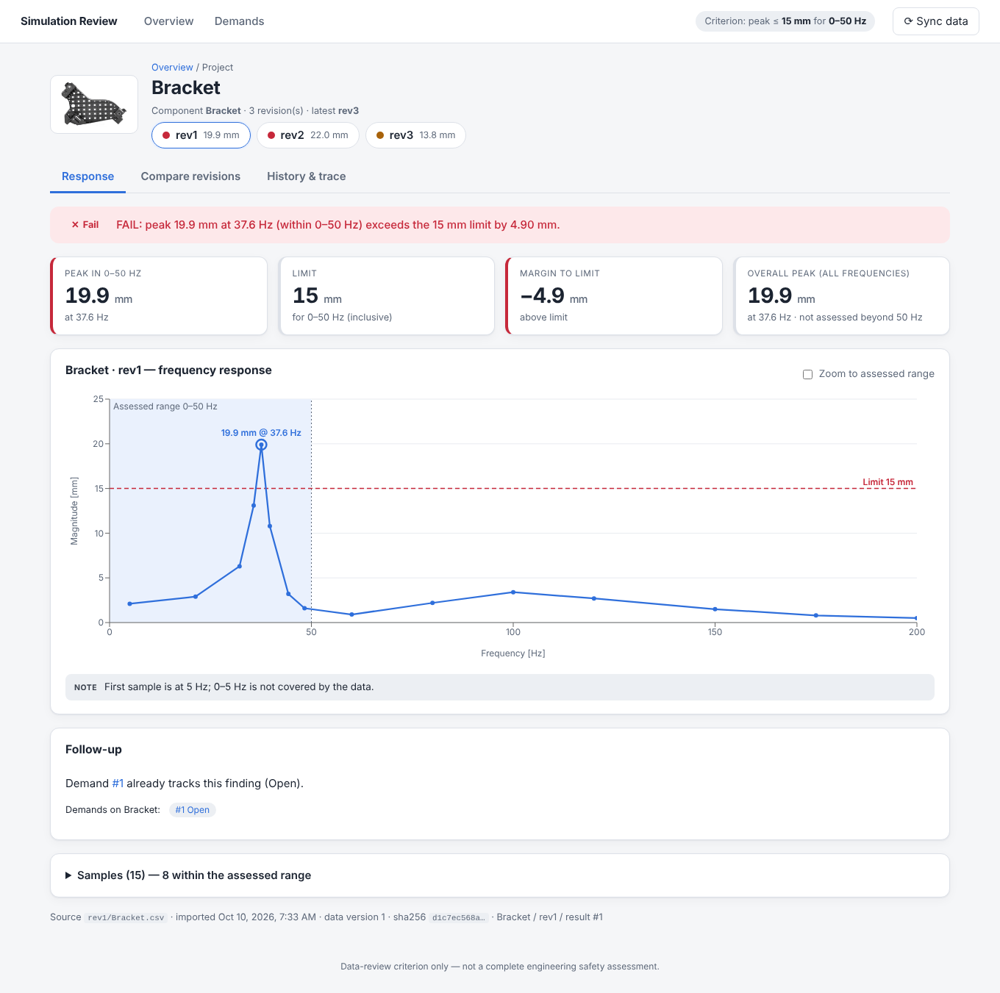
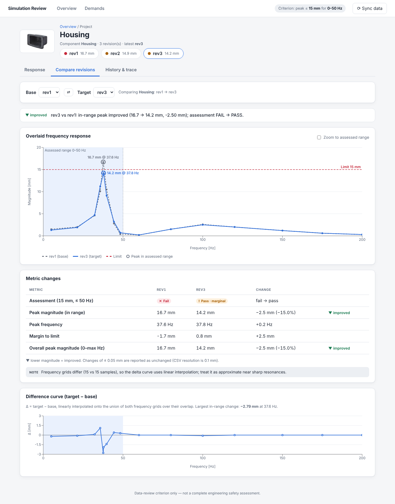
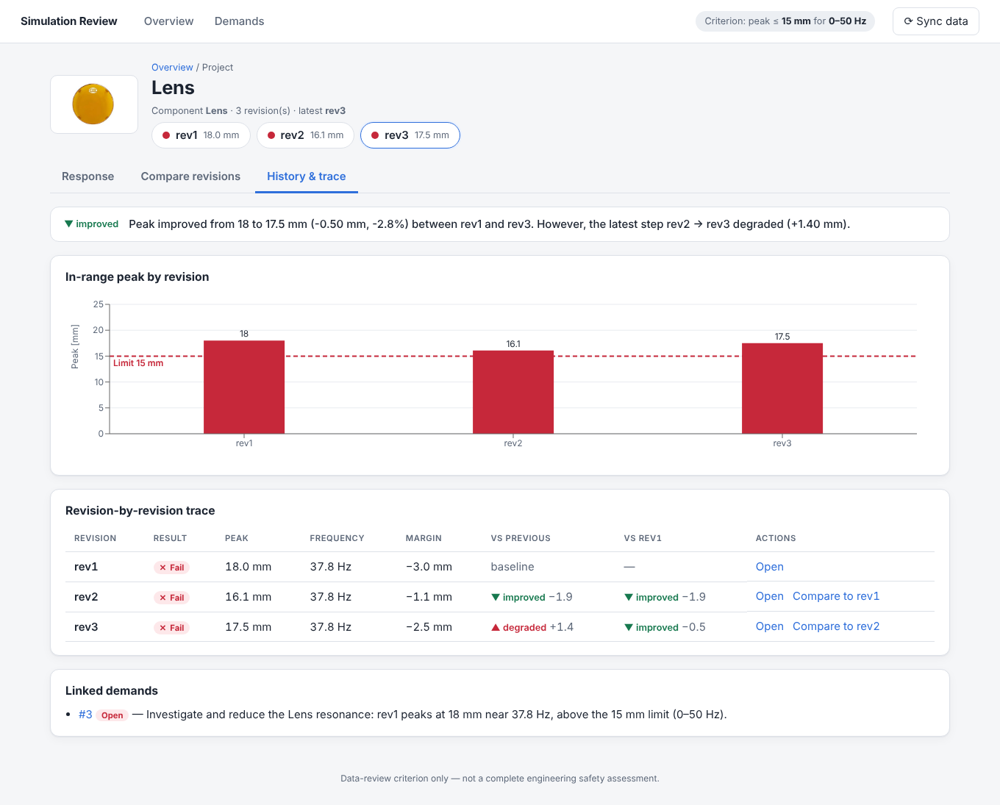
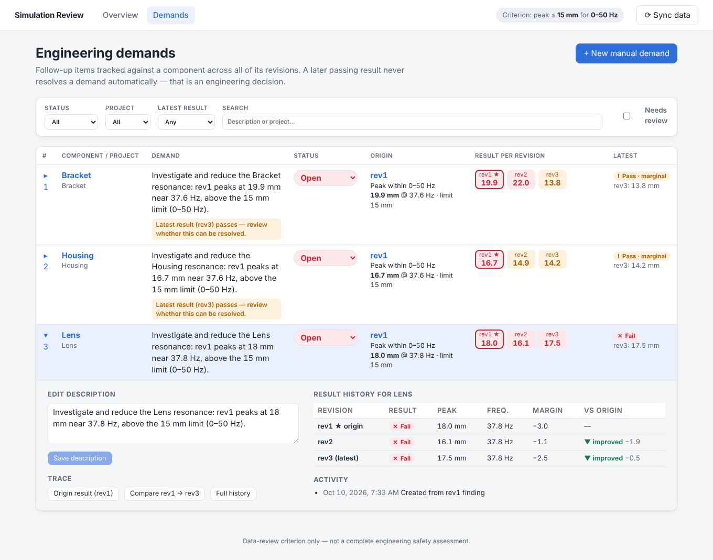

# Simulation Results Dashboard

Review frequency-response simulation results per project (Bracket, Housing, Lens), compare revisions, trace each
component across revisions and track engineering follow-up **demands** — all served from a SQLite database through a
FastAPI backend to a React/Vite frontend.

**Review rule (single source of truth: `backend/app/config.py`, exposed at `GET /api/criteria`):**
peak magnitude for **0 ≤ f ≤ 50 Hz (inclusive)** must be **≤ 15 mm**. Frequencies above 50 Hz are plotted but never affect
the verdict. This is a data-review criterion, not a safety assessment.

## Screenshots

| Overview | Response (failing revision) |
|---|---|
|  |  |
| **Compare revisions** | **History & trace** |
|  |  |

**Demands** (filterable table, expanded row shows result history across revisions)



## What the supplied data shows

| Component | rev1 | rev2 | rev3 | Reading |
|---|---|---|---|---|
| Bracket | 19.9 mm @ 37.6 Hz **fail** | 22.0 @ 37.8 **fail** (worse) | 13.8 @ 37.8 pass (marginal) | rev2 regressed, rev3 recovered |
| Housing | 16.7 **fail** | 14.9 pass (marginal, 0.1 mm) | 14.2 pass (marginal) | improving, but thin margin on a coarse grid |
| Lens | 18.0 @ 37.8 **fail** | 16.1 **fail** | 17.5 **fail** | improved then regressed; never passes |

## Quick start

Requirements: Python 3.11+, Node 20+.

```bash
./run.sh            # (or `bash run.sh`) install, build UI, import CSVs, seed demands, serve on http://localhost:8000
```

Or step by step:

```bash
# backend
cd backend
pip install -r requirements.txt
python -m app.cli import            # CSV -> SQLite (also runs automatically at server start-up)
python -m app.cli seed-demands      # optional: one demand per component from its rev1 failure (idempotent)
uvicorn app.main:create_app --factory --reload --port 8000

# frontend (dev server with API proxy, http://localhost:5173)
cd frontend
npm install
npm run dev
# or `npm run build` and let FastAPI serve frontend/dist on :8000
```

Interactive API docs: <http://localhost:8000/docs>.

### Tests
```bash
cd backend && python -m pytest          # 56 tests: parsing, assessment maths, importer, API, demands
cd frontend && npm test                 # formatting helpers
```

### Configuration (env vars)
| Variable | Default | Meaning |
|---|---|---|
| `SIM_INPUT_DIR` | `<repo>/Inputs` | root containing `<revision>/<Project>.csv` (+ optional `<Project>.png`) |
| `SIM_DATABASE_URL` | `sqlite:///backend/data/dashboard.db` | SQLAlchemy URL |
| `SIM_SYNC_ON_STARTUP` | `1` | run an import when the API starts |

## Using the dashboard

1. **Overview** – matrix of in-range peak per project × revision, latest status, trend vs previous/first revision,
   open demands and the result of the last data import (including files that were rejected and why).
2. **Project page** (click a project or a matrix cell)
   - *Response*: chosen revision's curve, assessed range shaded, limit line, peak circled and labelled, plain-language verdict,
     margin, caution notes (e.g. marginal pass, data ends before 50 Hz), full sample table, file provenance, and
     **Create demand from this finding** when the revision fails.
   - *Compare revisions*: pick base/target (swap button), overlaid curves, metric change table
     (assessment, peak, peak frequency, margin) with improved/degraded/unchanged tags and a Δ-curve.
   - *History & trace*: peak per revision vs limit, revision-by-revision table with change vs previous and vs first,
     links to each revision's result and pairwise comparison, and linked demands.
3. **Demands** – filter by status, project, latest result, free text, “needs review”. Change status inline, expand a row
   to edit the description, see the per-revision result history of that component, the origin finding, an activity log and
   links back to the origin result / origin→latest comparison.
4. **Sync data** (top right) – re-scans the input folder (`POST /api/import`). Drop a new `rev4/` folder or edit a CSV,
   click Sync, and everything updates; no restart needed.

## Data ingestion

Trigger: automatically at API start-up, on demand via **Sync data** / `POST /api/import`, or `python -m app.cli import`.

* Discovery walks `Inputs/<revision>/*.csv`; new revisions/projects are picked up with no code change. Revisions sort
  naturally (`rev2 < rev10`).
* Each file is identified by *(revision folder, file name)* and a SHA-256: unchanged → skipped; changed → updated in place in one
  transaction (samples replaced, `data_version` bumped, ids preserved so demand links survive); new → inserted. Repeat imports
  create no duplicates (unique constraint + tests).
* Validation rejects (whole file, never partial): wrong/missing header or unit (e.g. `[m]`), non-numeric/NaN/negative values,
  duplicate frequencies, empty files, binary/non-UTF-8. Unsorted rows are sorted with a note.
* One bad file never blocks the others. A file that *becomes* invalid keeps its last good data but is flagged "may be out of
  date"; a file removed from disk is flagged "source missing" rather than deleted. Stray CSVs/empty folders are reported.
* Every run is stored (`import_runs`, `import_issues`) and shown on the Overview.

## API (all JSON, all read from the DB)

| Method & path | Purpose |
|---|---|
| `GET /api/criteria` | limit, range, unit, tolerances |
| `GET /api/projects` | projects with revisions, latest status, trend, open demands |
| `GET /api/projects/{p}/revisions` | summaries for each revision |
| `GET /api/projects/{p}/revisions/{r}` | summary + samples (with `in_range` flag) |
| `GET /api/projects/{p}/compare?base=&target=` | metrics, deltas, verdict, overlay samples, interpolated Δ-curve |
| `GET /api/projects/{p}/history` | trace across revisions with change vs previous/first |
| `POST /api/import`, `GET /api/import/latest` | sync + last run report |
| `GET /api/demands?status=&project=&origin_revision=&latest_status=&q=` | list/filter demands |
| `POST /api/demands` | `{project, description, origin_revision?}` — with `origin_revision` it is created from that failed finding (422 if the result is not a failure, 409 if an unresolved demand already exists for it); without, it is manual |
| `GET/PATCH /api/demands/{id}` | read / update `description` and `status` |

## Layout

```
backend/app/
  config.py        criterion + settings            services/parsing.py    CSV validation (pure)
  models.py        SQLAlchemy schema               services/metrics.py    assessment + comparison maths (pure)
  db.py            engine/session                  services/discovery.py  folder scan (no DB)
  schemas.py       API response models             services/importer.py   idempotent sync
  api/routes.py    thin HTTP layer                 services/views.py      DB rows -> responses
  cli.py           import / seed-demands           services/demands.py    demand rules
frontend/src/      api.ts (typed client) · pages/ · components/ · format.ts
Inputs/            supplied CSVs and part images
```
See **DECISIONS.md** for assumptions, design rationale, alternatives and open questions.
